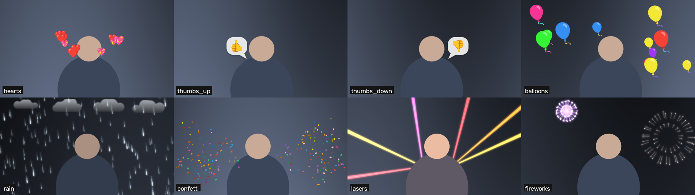

# gestcam

Apple-style gesture reactions (hearts, thumbs, balloons, rain, confetti, lasers, fireworks) for **any** video-call app on Linux, delivered as a virtual camera. Built for Omarchy (Arch + Hyprland), works on any Linux with `v4l2loopback`.

| Gesture | Reaction | Gesture | Reaction |
|---|---|---|---|
| 👍 | thumbs up | 👍👍 | fireworks |
| 👎 | thumbs down | 👎👎 | rain |
| ✌️ | balloons | ✌️✌️ | confetti |
| 🫶 two-hand heart | hearts | 🤘🤘 | lasers |

Hold the gesture ~0.7 s, away from your face. A white ring shows hold progress and the
emoji of what is about to fire, so a misread can be dropped before it lands.

- **One hand, then the other is fine.** 👍 then a second 👍 gives fireworks, timed from
  the *first* thumb. If 👍 already fired, the second thumb still upgrades it: fireworks
  fire and the bubble fades out. Never two reactions for one gesture.
- With two hands in frame, a one-hand gesture waits an extra 0.15 s (`--defer`) in case
  the other hand is on its way. With one hand in frame there is no wait.
- After a reaction, 2.5 s of cooldown. The same reaction again needs you to drop the
  gesture for 0.5 s; firing it while it is still playing extends it instead of stacking.
- Hearts: index tips touching and thumb tips touching, thumbs down or up. Horns are
  two-handed only (as on macOS).

With a person mask (on by default), fireworks, rain, lasers and some balloons and
confetti play **behind** you; thumbs and hearts stay in front, beside your head.

## Install

```sh
git clone <this repo> && cd gestcam
uv sync                       # or: python -m venv .venv && . .venv/bin/activate && pip install -e .
uv run gestcam doctor         # read this before anything else
```

`doctor` reports kernel headers, module state, video devices, PipeWire, Discord install type, and prints copy-paste fixes. Share `uv run gestcam doctor --json` when asking for help.

## One-time: virtual camera device

```sh
./scripts/loopback.sh         # installs v4l2loopback-dkms + headers, loads TWO devices, persists
```

You get **GestCam** on `/dev/video10` and **GestCam2** on `/dev/video11`. gestcam
publishes identical frames to both.

Two devices, because **one v4l2loopback device serves exactly one streaming consumer.**
The second app to start gets `Device or resource busy` (`VIDIOC_REQBUFS` → `EBUSY`) and
shows black — `open()` succeeds, which is why it looks like the app "can't see" the
camera when it is listed the whole time. So: point the native Discord app at GestCam and
Discord in your browser at GestCam2. Need a third app? Add a third `video_nr`/label to
`MODOPTS` in `scripts/loopback.sh`.

`exclusive_caps=1` is not optional either: Chromium-based apps (Discord web, Chrome,
Electron) hide loopback devices without it. It is a **per-device array** — a bare
`exclusive_caps=1` with two devices silently leaves the second one invisible.

## Run

```sh
uv run gestcam demo --out demo.mp4     # every reaction on a synthetic scene, no camera/model needed
uv run gestcam run                     # webcam → /dev/video10 ("GestCam")
uv run gestcam run --preview           # + local window (XWayland)
uv run gestcam run --width 640 --height 480 --infer-every 2   # slow machine
```

Then in Discord → Voice & Video → Camera → **GestCam** (or **GestCam2** if something else
already holds the first). Discord remembers the choice, so it is a one-time pick per app.
Check without Discord: `mpv av://v4l2:/dev/video10`.

There is no way to layer reactions onto a camera an app has *already* selected — that
would need an OS-level camera-effects layer, which is exactly what macOS has and Linux
does not. Selecting GestCam once per app is the whole of the workaround.

Flags worth knowing: `--hold 0.7` `--cooldown 2.5` `--defer 0.15` `--min-score 0.5`
`--detect-conf 0.5` `--num-hands 2` `--no-segment` `--mirror` `--record out.mp4`
`--out none` (preview only).

### Person segmentation and what it costs

A second MediaPipe model (Google's selfie segmenter, 250 KB, downloaded next to the
gesture model) runs on its own thread off the same 640 px frame. Measured on an
i7-13620H, 1280x720, all 8 effects firing in rotation:

| | mask on | `--no-segment` |
|---|---|---|
| output | 30 fps | 30 fps |
| main loop p50 / p95 | 10.8 / 14.2 ms | 5.1 / 7.9 ms |
| gesture model p50 / p95 | 16.9 / 23.9 ms | 15.8 / 22.5 ms |
| segmenter p50 / p95 | 7.9 / 10.8 ms | – |

The extra loop time is compositing the back layer under you. (The "mask on" column ran
the segmenter on every frame. It now runs only while a gesture is held or an effect is
on screen, which are the only times anything reads the mask, so an idle call costs the
same as `--no-segment`.) If either model's p95, or the loop p95 of frames that used the
mask, stays over 33 ms for two 5 s stats windows (a starved CPU), gestcam turns the mask
off for the rest of the session and says so. Effects then draw over you, as with
`--no-segment`.

## When a gesture doesn't fire

```sh
uv run gestcam run --debug                          # landmarks, per-hand pose, decision, hold timers on the output
uv run gestcam run --record-raw me.mp4              # save what the model sees (no effects)
uv run gestcam eval me.mp4                          # replay it: per-frame labels/poses/handedness, every fire
uv run gestcam eval photos/ --expect balloons       # a folder of stills, each held 1.2 s; exit 1 on a miss
```

`eval` runs the same decision code as `run` (model in VIDEO mode on the clip's own
timestamps, then pairing, then the hold logic). `--record-raw` writes the real capture
times next to the clip (`me.mp4.ts.json`), and `eval` replays on those, so a loop or
camera that ran below its claimed fps is timed as it was live. Each still is held long
enough for `--hold` + `--defer` (1.2 s at the defaults). `--expect` exits 2 on an
unknown reaction, an empty folder or an unreadable clip, so it never passes on nothing.
`eval` takes the same `--detect-conf`,
`--num-hands`, `--hold`, `--defer`, `--min-score` flags, so you can tune on a
recording instead of waving at the camera. `--json` gives every frame.

Each hand gets one pose from the canned label and the landmark geometry together: the
canned model alone called clear ✌️ signs `None` 4 times in 6. On 22 Commons photos
(`gestcam eval`), 10 of the 20 gesture photos fire the right reaction, one more fires
the one-hand version because only one of its two hands is found, and none fires
anything else. The misses are hands the palm detector never finds (hearts especially).

## Troubleshooting

| Symptom | Cause / fix |
|---|---|
| Discord doesn't list GestCam | module loaded without `exclusive_caps=1`; or gestcam isn't running (loopback only advertises capture once a producer is attached). Also try disabling `chrome://flags/#enable-webrtc-pipewire-camera` if it's on. |
| Camera works in one app, black in another | both are fighting for the same device — one loopback serves one consumer. Point the second app at **GestCam2**. `uv run gestcam doctor` names the process holding each device. |
| Discord in the browser shows black while the app works | same thing: the native app has `/dev/video10`. Use GestCam2 in the browser. |
| `modprobe: FATAL: Module v4l2loopback not found` | headers missing for the running kernel → `pacman -S linux-headers`, `dkms autoinstall`, reboot. Happens after every kernel update until dkms rebuilds. |
| Module refuses to load, Secure Boot on | unsigned DKMS module. Sign it or disable Secure Boot. |
| Webcam gives 5 fps at 720p | camera stuck in YUYV. gestcam requests MJPG; check `v4l2-ctl -d /dev/video0 --list-formats-ext`. |
| `--preview` window doesn't open | pip OpenCV bundles Qt5 without Wayland support; gestcam sets `QT_QPA_PLATFORM=xcb`. Needs XWayland (`echo $DISPLAY`). |
| Reactions fire on their own | raise `--min-score`, or `--hold 1.0`. Record it with `--record-raw` and see why with `gestcam eval`. |
| A gesture never fires | `--debug` shows whether the hand is found and what pose it reads. No landmarks at all = palm detector miss: try `--detect-conf 0.3`, more light, hands further from the face. |
| Effects drawn over your face | the person mask is off: `--no-segment`, a failed segmenter download (see the log), or the CPU auto-off line in the log. |
| First run hangs at "downloading gesture model" | needs network to fetch `gesture_recognizer.task` (~8 MB) and `selfie_segmenter.tflite` (250 KB) into `~/.cache/gestcam/`. Pass `--model path` to use a local copy. `doctor` says whether both are cached. |
| `ImportError` around cv2 | two OpenCV packages installed. Keep only `opencv-contrib-python`. |

## Credits

Gesture model and selfie segmenter: MediaPipe Tasks models by Google (Apache-2.0),
downloaded on first run, not vendored. Emoji sprites: Noto Color Emoji (Apache-2.0),
vendored in `gestcam/assets/`. No Apple code or assets: macOS Reactions are the
behavioural reference only.

 (`gestcam demo --sheet reactions-sheet.png`)
