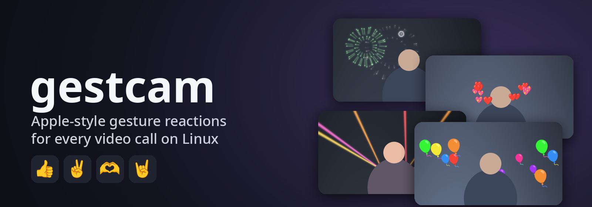
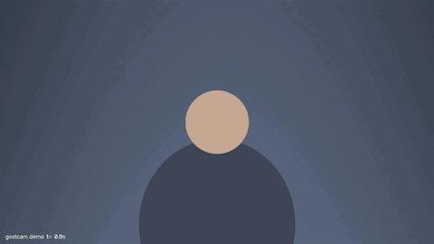
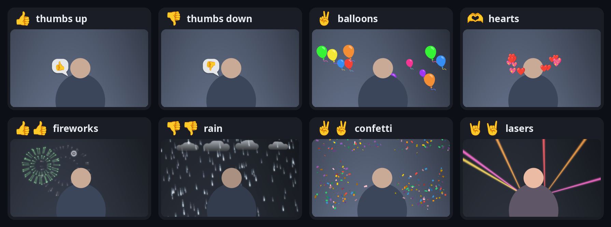
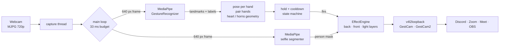

<p align="center">
  
</p>

<p align="center">
  <a href="https://github.com/yashksaini-coder/gestcam/actions/workflows/ci.yml"></a>
  
  
  <a href="LICENSE"></a>
</p>

<p align="center">
  <b>Show a 👍, ✌️, 🫶 or 🤘 to your webcam and Discord, Zoom, Meet or OBS sees fireworks, balloons, hearts or lasers.</b><br>
  macOS does this in its camera stack. gestcam does it on Linux as a virtual camera, so it works with every app.
</p>

<p align="center">
  <a href="#quick-start">Quick start</a> ·
  <a href="#gestures">Gestures</a> ·
  <a href="#usage">Usage</a> ·
  <a href="#how-it-works">How it works</a> ·
  <a href="#troubleshooting">Troubleshooting</a> ·
  <a href="#development">Development</a>
</p>

<p align="center">
  
</p>

## Features

- **8 reactions, same gestures as macOS.** The one-hand gestures are 👍 👎 ✌️ and the two-hand ones are 👍👍 👎👎 ✌️✌️ 🫶 🤘🤘.
- **Effects go behind you.** A person mask puts fireworks, rain and lasers behind you, and balloons and confetti both behind and in front, just like Apple's.
- **Feels deliberate, not twitchy.** Hold a gesture for about 0.7 s and a ring shows progress plus the emoji that is about to fire. 👍 followed by a second 👍 upgrades to fireworks; you never get two reactions for one gesture.
- **Background replacement.** `--bg remove`, `--bg blur` or `--bg photo.jpg`.
- **Works in any app at once.** Two virtual cameras, so the native Discord app and Discord in a browser can both use it.
- **Runs on a laptop CPU.** 30 fps at 720p and no GPU needed. Everything runs locally; the only network use is fetching the two models once.
- **Built to be debuggable.** `doctor` explains your setup, `--debug` draws what the model sees, and `eval` replays a recording offline.

## Quick start

```bash
uv tool install git+https://github.com/yashksaini-coder/gestcam   # or: pipx install git+https://…
gestcam setup     # one time: virtual cameras (asks for sudo) + models
gestcam run       # then pick "GestCam" as the camera in Discord / Zoom / Meet
```

Want to see it before wiring up any app? `gestcam run --preview` opens a local window.
If the virtual cameras aren't set up yet, `gestcam run` falls back to that window by itself.

<details>
<summary>Requirements</summary>

- Linux on x86_64 with glibc ≥ 2.28 (Arch, Ubuntu 20.04+, Fedora, Debian 10+). MediaPipe ships no aarch64 Linux build.
- Python 3.11–3.14. `uv` / `pipx` choose one for you.
- A webcam, and `v4l2loopback`. `gestcam setup` installs it on Arch, Debian/Ubuntu and Fedora.
- Desktop GL libraries (`libGL`, `libGLESv2`, `libEGL`). Any desktop install already has them; on a bare server, `apt install libgl1 libgles2 libegl1`.

</details>

<details>
<summary>From a clone</summary>

```bash
git clone https://github.com/yashksaini-coder/gestcam && cd gestcam
uv sync
uv run gestcam setup
uv run gestcam run
```

</details>

## Gestures

<p align="center"></p>

| One hand | Reaction | Two hands | Reaction |
|:-:|---|:-:|---|
| 👍 | thumbs-up bubble beside your head | 👍👍 | fireworks behind you |
| 👎 | thumbs-down bubble | 👎👎 | rain clouds, the room darkens |
| ✌️ | balloons | ✌️✌️ | confetti |
| | | 🫶 | hearts |
| | | 🤘🤘 | lasers, with light cast on you |

How to make them land:

- **Hold it still for about 0.7 s,** away from your face and with your palm toward the camera. The ring fills, then the effect fires, followed by 2.5 s of cooldown.
- **🫶 Heart:** touch both index fingertips and both thumb tips. With the thumbs at the bottom, curl the other fingers in; if they stand straight up it reads as a "picture frame" pose. Upside down (thumbs on top) also works, with your fingers pointing down.
- **🤘 Horns need two hands,** as on macOS.
- **One hand, then the other, is fine.** Raise 👍 then a second 👍 and you get fireworks, timed from the first thumb. If 👍 already fired, it upgrades instead of stacking.
- **Repeat to extend.** Doing the same gesture while its effect is playing extends the effect.

## Usage

| Command | What it does |
|---|---|
| `gestcam setup` | One time: install and load v4l2loopback (two devices, persists across reboots), fetch both models, run `doctor`. `--show` prints the root script first. |
| `gestcam run` | Webcam → gestures → reactions → virtual cameras. |
| `gestcam doctor` | Checks kernel module, devices, PipeWire, models and Discord install type, and prints copy-paste fixes. `--json` gives output to attach to a bug report. |
| `gestcam demo` | Every reaction on a synthetic scene, no camera or model needed. `--preview`, `--out demo.mp4`, `--sheet sheet.png`. |
| `gestcam eval <clip\|dir>` | Replays a recording or a folder of photos through the same recognition and hold logic, and prints what would fire. |
| `gestcam cameras` | Lists video devices. |

Common `run` options:

| Option | Default | |
|---|---|---|
| `--preview` | off | also show a local window |
| `--bg remove\|blur\|IMAGE` | off | replace the background behind you |
| `--mirror` | off | flip the output horizontally |
| `--hold S` / `--cooldown S` | 0.7 / 2.5 | how long to hold a gesture, and the wait between reactions |
| `--min-score X` | 0.5 | raise it if reactions fire on their own |
| `--detect-conf X` | 0.5 | lower it (e.g. 0.3) if hands aren't found in dim light |
| `--no-segment` | off | no person mask: effects draw over you and save ~5 ms of CPU |
| `--width/--height/--fps` | 1280/720/30 | for a slow machine: `--width 640 --height 480 --infer-every 2` |
| `--out` | auto | `auto` = every GestCam device, or `/dev/video10`, or `none` |
| `--record F` / `--record-raw F` | – | save the output, or what the model sees, for `eval` |
| `--debug` | off | landmarks, per-hand pose, decision and hold timers |

See `gestcam run --help` for the rest.

### Picking the camera in your app

Discord → Settings → Voice & Video → Camera → **GestCam**. Apps remember the choice, so you
only pick it once per app. gestcam publishes the same frames to **GestCam** (`/dev/video10`)
and **GestCam2** (`/dev/video11`), because one loopback device serves exactly one app at a
time: point the native app at one and the browser at the other. You can check either one
without any app: `mpv av://v4l2:/dev/video10`.

## How it works



- **Recognition:** each hand gets one pose from MediaPipe's gesture label and the landmark geometry together. The label alone called clear ✌️ signs `None` 4 times in 6. Two hands are paired before they're classified, so a two-hand gesture is never downgraded to its one-hand version.
- **Timing:** each reaction builds up its own hold time on the camera's timestamps, so a slow frame doesn't stretch it. Short dropouts are bridged, and a second hand arriving upgrades the reaction rather than restarting it.
- **Compositing:** effects draw in three passes around the person mask: behind you, in front of you, and light cast on you. Blending stays in 8-bit through OpenCV (2.2 ms against 18.9 ms in float NumPy).
- **Speed:** both models run on MediaPipe's own threads, so the main loop only reads the latest result. The person mask only runs while a gesture is held or an effect is on screen, so an idle call costs the same as `--no-segment`. If the CPU can't keep 30 fps for two 5-second windows, the mask switches itself off and the log says so. With `--bg` it stays on, since switching it off would show your room.

On 22 photos (`gestcam eval`), 11 fire the right reaction, one fires the one-hand version of a two-hand gesture, and none fires the wrong reaction. Every miss is a hand that MediaPipe's palm detector never finds; hearts are the hardest. `PLAN.md` has the design record and the measurements behind each decision.

<details>
<summary>Why a virtual camera, and not a Discord plugin?</summary>

Because Discord has no gesture feature. On macOS, Reactions are applied by Apple's
AVFoundation camera stack for every app. Unpacking `Discord.dmg` (v0.0.419) shows no
gesture or reaction code anywhere: Chromium only reads
`AVCaptureDevice.reactionEffectsEnabled` to log a usage metric. Linux has no
camera-effects layer between your webcam and an app, so a virtual camera that apps
select once is the equivalent.

</details>

## When a gesture doesn't fire

```bash
gestcam run --debug --preview          # is the hand found? what pose does it read?
gestcam run --record-raw me.mp4        # record what the model sees (no effects)
gestcam eval me.mp4                    # replay it: per-frame poses, every fire
gestcam eval photos/ --expect balloons # a folder of stills; exit 1 on a miss
```

`eval` runs the same decision code as `run`, on the clip's real capture timestamps
(`me.mp4.ts.json`), and takes the same tuning flags (`--hold`, `--defer`, `--min-score`,
`--detect-conf`). That way you can tune on a recording instead of waving at the camera.

## Troubleshooting

| Symptom | Cause / fix |
|---|---|
| Discord doesn't list GestCam | The module was loaded without `exclusive_caps=1` (re-run `gestcam setup`), or gestcam isn't running: the loopback only appears as a camera once something is writing to it. If `chrome://flags/#enable-webrtc-pipewire-camera` is on, try turning it off. |
| Works in one app, black in another | Both apps are using the same device. Point the second at **GestCam2**. `gestcam doctor` names the process holding each device. |
| `modprobe: FATAL: Module v4l2loopback not found` | Kernel headers are missing for the running kernel. Install them, run `dkms autoinstall`, and reboot. This comes back after kernel updates until dkms rebuilds. |
| Module refuses to load, Secure Boot on | The DKMS module is unsigned. Sign it or disable Secure Boot. |
| Webcam gives 5 fps at 720p | The camera is stuck in YUYV. Check `v4l2-ctl -d /dev/video0 --list-formats-ext`. |
| `--preview` window doesn't open | The pip build of OpenCV needs XWayland on Wayland (`echo $DISPLAY`). |
| `libGLESv2.so.2: cannot open shared object file` | Install your distro's GLES/EGL libraries (`libgles2 libegl1` on Debian/Ubuntu). |
| Reactions fire on their own | Raise `--min-score` or use `--hold 1.0`. Record it with `--record-raw` and see why with `eval`. |
| A gesture never fires | Use `--debug`. If no landmarks appear, the palm detector is missing your hand: try `--detect-conf 0.3`, more light, or hands further from your face. |
| Effects drawn over your face | The person mask is off: `--no-segment`, a failed model download, or the CPU auto-off line in the log. |
| First run hangs at "downloading" | It's fetching the models (~8 MB) into `~/.cache/gestcam/`. `gestcam setup` does this up front, and `--model PATH` uses a local copy. |
| `ImportError` around cv2 | Two OpenCV packages are installed. Keep only `opencv-contrib-python`. |

Still stuck? Open an issue with `gestcam doctor --json` attached.

## Development

```bash
uv sync                                   # dev group included
uv run pytest                             # ~160 tests; model-backed ones run once the models are cached
uvx ruff check .                          # same rules as CI
uv run gestcam demo --preview             # tune visuals without a camera
uv run --with pillow python scripts/readme_art.py   # regenerate docs/img/
```

CI runs lint, the lockfile check, tests on Python 3.11–3.14 with real model inference,
and a build that installs the wheel into a clean venv and renders the demo.
[`docs/SHIPPING.md`](docs/SHIPPING.md) is the packaging plan, and [`PLAN.md`](PLAN.md) is the design record.

## Credits

- Gesture recognizer and selfie segmenter: [MediaPipe](https://ai.google.dev/edge/mediapipe) models by Google (Apache-2.0). They are downloaded on first run, not vendored.
- Emoji sprites: [Noto Color Emoji](https://github.com/googlefonts/noto-emoji) (Apache-2.0), vendored in `gestcam/assets/`.
- macOS Reactions are the behavioural reference only. There is no Apple code or assets in this project.

## License

[MIT](LICENSE)
